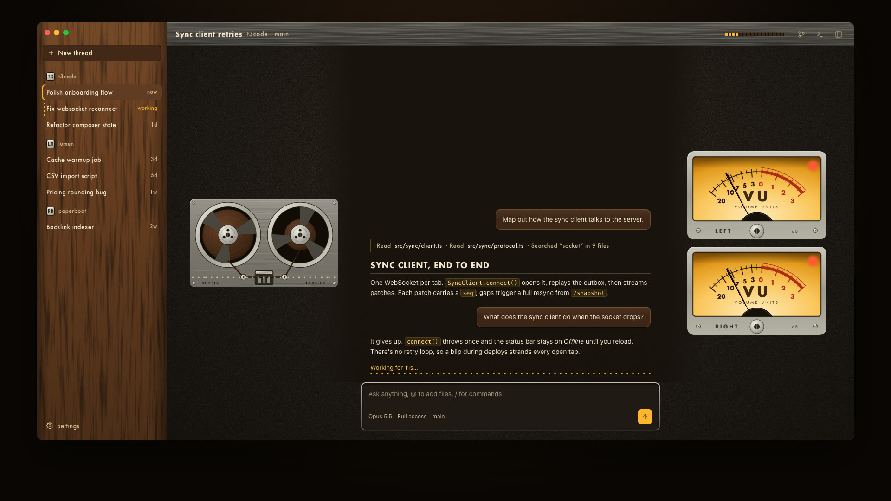

# Reel to Reel

**A 1970s tape-deck theme for [T3 Code](https://t3.codes).** Walnut, brushed aluminium and amber VU meters. While your agent works the reels turn and the needles bounce. When the turn ends the needles thump and settle.

**[See it in motion →](https://joshsaintjacque.github.io/t3code-theme-reel-to-reel/)**



## Install

**From the app**

1. Download [`reel-to-reel.json`](reel-to-reel.json), or copy its contents.
2. In T3 Code, open **Settings › Appearance › Add theme**.
3. Choose the file, or paste the JSON, and add it.

**From the terminal**

```sh
curl -fsSL -o reel-to-reel.json https://joshsaintjacque.github.io/t3code-theme-reel-to-reel/reel-to-reel.json
~/.t3/bin/t3 theme set reel-to-reel.json
```

`t3 theme set` publishes the file and sets it as the environment theme, so every client connected to that environment switches to it.

Built against T3 Code 0.1.11 (nightly).

## What moves, and when

Every animation is tied to real app state. If nothing is running, nothing moves. Needles park on the stop, lamps are out.

| State | Motion |
|---|---|
| **Turn running, first 7 seconds** | Twin reels in an aluminium deck plate (left margin) turn at different speeds and a strip of tape runs past the head. Two VU meters (right margin) swing hard, each with its own ballistics, and their REC lamps light. A 16-segment LED ladder at the right end of the header climbs in steps. |
| **Turn running, after 7 seconds** | The needles settle to a low, slow sway with the occasional peak; the ladder drops to a low level. Long turns stay calm in peripheral vision. |
| **Turn complete** | The needles fall from wherever they were to the stop and bounce off it, the REC lamps fade out and the ladder drops in steps. It is a transition, so it never replays on page load or when you switch threads. The reels stop where they are. |
| **Background thread busy** | The thread row gets a stepping tape stripe. If only a background thread is running, just the right meter sways and its lamp is lit. |
| **Working row** | A line of sprocket holes steps along the foot of the live *Working...* row. |
| **Composer focus** | The recessed composer's aluminium bezel lights amber. |
| **Hover** | Thread rows get an aluminium edge; the selected row keeps the amber one. |
| **Narrow windows** | Under 1460px there is no gutter, so a small dock (mini reels and meters) sits in the sidebar under Settings, in flow, never behind a thread title. |
| **Reduced motion** | Everything stops. Idle shows the true rest pose; a running turn shows a held pose (needles raised, lamps lit, ladder at mid level), so the state is still readable. |

## Palette

Walnut and vinyl for the dark, aluminium for the metal, and one amber for everything that needs you.

| Role | Hex |
|---|---|
| Canvas | `#1b1511` |
| Sidebar | `#2e1c10` |
| Toolbar | `#3a3631` |
| Message | `#3d2517` |
| Text | `#f3e7cf` |
| Muted | `#cdbb98` |
| Accent | `#ffb52e` |
| Aluminium | `#d4cfc4` |
| Update | `#8ed8a4` |
| Error | `#ff8f7d` |

## Build it yourself

`reel-to-reel.json` is generated. Edit [`source/build.py`](source/build.py) and run it:

```sh
python3 source/build.py
```

It rewrites the theme JSON, the SVG previews and `index.html`.

## Licence

MIT. Not affiliated with T3 Code or its makers.
